<div align="center">
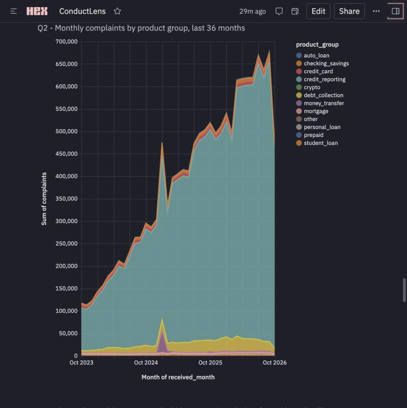 <br />

# ConductLens

### CFPB complaints, FDIC deposits and FRED rates &rarr; BigQuery &rarr; dbt &rarr; Airflow &rarr; Hex


**Live dashboard:** https://app.hex.tech/01a163f8-ca27-778d-b53b-c4897ad7cb97/app/ConductLens-034ldzYONZwINhuDl3OsJu/latest

</div>

## :bookmark_tabs: Menu

- [Business problem](#business-problem)
- [Architecture](#architecture)
- [Ingestion](#ingestion)
- [Google BigQuery](#google-bigquery)
- [Why two warehouses](#why-two-warehouses)
- [dbt](#dbt)
- [Apache Airflow](#apache-airflow)
- [Hex dashboard](#hex-dashboard)
- [Design decisions](#design-decisions)
- [Time zone](#time-zone)
- [What a failure looks like, and how the pipeline recovers](#what-a-failure-looks-like-and-how-the-pipeline-recovers)
- [Footprint and cost](#footprint-and-cost)
- [Evidence of unattended runs](#evidence-of-unattended-runs)
- [Budget](#budget)
- [Folder structure](#open_file_folder-folder-structure)
- [Requirements](#exclamation-requirements)
- [Author](#smiley_cat-author)

## Business problem

Every complaint a US consumer escalates to the Consumer Financial Protection Bureau about a bank,
a card issuer, a fintech or a debt collector becomes public within days. For a challenger bank that
is three things at once: Compliance uses it to spot regulatory exposure, Customer Operations wants
to know whether service is getting better or worse relative to peers, and Product wants to know
which products and issues are generating friction across the industry. Today each of those teams
downloads a CSV by hand once a quarter.

ConductLens replaces the quarterly CSV with a pipeline that lands the full CFPB Consumer Complaint
Database (18.7 million complaints since December 2011, refreshed daily), the FDIC institution
register (every US charter with its deposits) and a set of daily interest-rate series from FRED,
models them with dbt, runs every day on Airflow and publishes a public Hex dashboard that answers
ten business questions:

| Area | Questions |
|---|---|
| Volume and trend | **Q1** complaints this week, month and year to date vs the same period last year · **Q2** which products and issues are growing fastest; are BNPL, crypto and money transfer taking share from cards and mortgages |
| Service quality | **Q3** share of complaints each company answers within the 15-day window, trailing twelve months · **Q4** how companies resolve complaints (explanation, monetary relief, non-monetary relief, in progress) · **Q5** share of consumers who dispute the response |
| Benchmarking | **Q6** complaints per billion dollars of deposits, and where our bank ranks among peers of similar size · **Q7** are digital-first companies handled differently from chartered banks |
| Risk and early warning | **Q8** which companies spiked this week more than two standard deviations above their trailing 8-week average, and on which issue · **Q9** do mortgage and credit-card complaints move with interest rates, and with what lag |
| Geography | **Q10** complaint rate per capita by state, and how the product mix differs by region |

Everything runs inside free allowances: the BigQuery sandbox (no billing account), a local Docker
Airflow, and a Hex workspace. The project is built in three layers:

- #### Ingestion <font color='gray'>(Python: download, normalise, hash, load incrementally)</font>
- #### Modelling <font color='gray'>(dbt on BigQuery: staging, intermediate, marts, snapshot, tests, docs)</font>
- #### Orchestration and serving <font color='gray'>(Airflow DAGs with one task per dbt model; Hex app)</font>

## Architecture

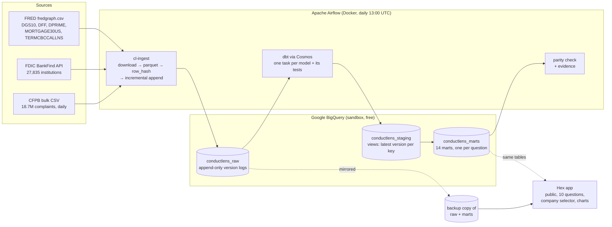

**How data moves.** Once a day Airflow downloads the CFPB bulk file (358 MB zipped), converts it
to parquet in 22 seconds, hashes every complaint's business columns, and appends to BigQuery only
the rows whose `(complaint_id, row_hash)` are not already there. FDIC and FRED follow the same
pattern. dbt then rebuilds the staging views and the marts; every model and every test is its own
Airflow task, so a red box names the model that broke. The marts are the only tables the dashboard
reads.

**The backup copy.** The BigQuery sandbox is free but every table in it expires after 60 days.
So the pipeline keeps a second copy of the raw logs and the marts in Databricks Free Edition, where
tables never expire, and binds the public app to that copy so it never goes dark. See
[Why two warehouses](#why-two-warehouses).

## Ingestion

The `cl-ingest` package (in `ingestion/`) is the only writer of the raw layer.

| Source | What is pulled | How often | Incremental rule |
|---|---|---|---|
| CFPB Consumer Complaint Database | the daily bulk CSV, all 15 published columns, no narratives | daily | re-hash the trailing 60 days of `received_date`, append new or changed versions, tombstone rows that disappeared; a weekly `full_diff` does the same over all history |
| FDIC BankFind `/institutions` | every charter, active and inactive: name, holding company, deposits, assets, class, dates | daily (small) | append a new version only when any field changed |
| FRED `fredgraph.csv` | five rate series since 2011 | daily | re-pull the trailing 90 days (FRED revises), append changed observations |

Why a trailing window and not "new rows since yesterday": a complaint is published when
received, and the company response, the timeliness flag and (historically) the dispute flag fill
in over the following weeks. Incremental by received date would freeze every complaint in its
day-one state. The window re-pull plus the hash makes re-running any date range safe: the same rows
hash to the same values, are found present, and nothing is written twice.

```
cl-ingest run --source cfpb --mode incremental        # the daily call
cl-ingest run --source all  --mode backfill --start 2024-01-01 --end 2024-06-30
cl-ingest run --source cfpb --mode full_diff           # Sundays: re-hash all 18.7M rows
cl-ingest ensure-tables                                # create / rotate expiring tables
cl-ingest status                                       # watermarks and the last runs
```

Every attempt, successful or not, is a row in `conductlens_raw._load_runs`; the watermark per
source lives in `conductlens_raw._load_state` and is only ever raised.

## Google BigQuery

The warehouse is a BigQuery **sandbox** project: no billing account, 10 GiB of lifetime storage,
1 TiB of query processing a month, no DML, and every table expires 60 days after it is created.
Three datasets hold the three dbt layers.

| Dataset | Contents | Materialisation |
|---|---|---|
| `conductlens_raw` | `cfpb_complaints_daily`, `cfpb_codes`, `fdic_institutions`, `fred_observations`, `_load_runs`, `_load_state`, `_parity_checks` | created by ingestion; integer-range partitioned by `received_month_id`, clustered by company and product |
| `conductlens_staging` | `stg_*` and `int_*` | views, so a rebuild writes nothing against the lifetime budget |
| `conductlens_marts` | 14 marts, one per business question, plus `dim_company` | small tables rebuilt daily (a few MB) |

The complaint log lands at the **daily-cell grain**: one row per
`received_date × company × product × sub-product × issue × state × response × timely flag`, with the
strings replaced by integer codes from `cfpb_codes`. Those 5.16 million cells sum to exactly the
18,653,525 complaints in the file, and they cost 0.69 GB instead of the 7.7 GB the complaint-level
rows would cost. The reasoning is in [design decision 7](#design-decisions).

The three datasets in the sandbox project, raw tables and marts expanded, and the staging layer as views:

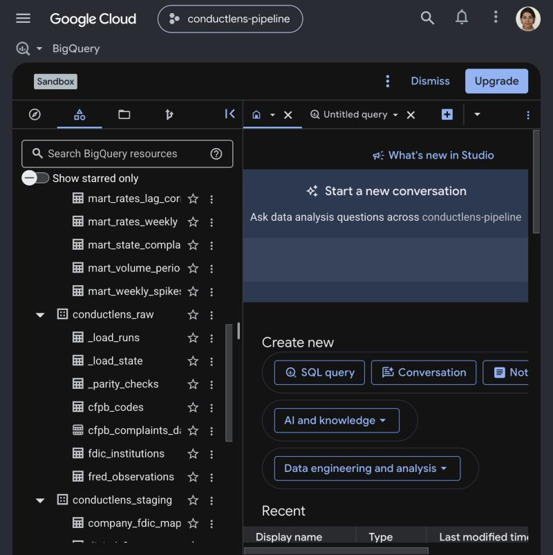
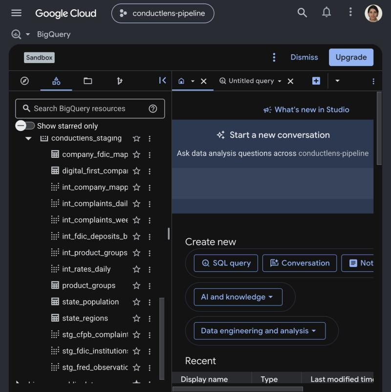

The complaint cell table: integer-range partitioned on `received_month_id`, clustered by company and
product, and, like every sandbox table, carrying a 60-day expiration that the pipeline rotates:

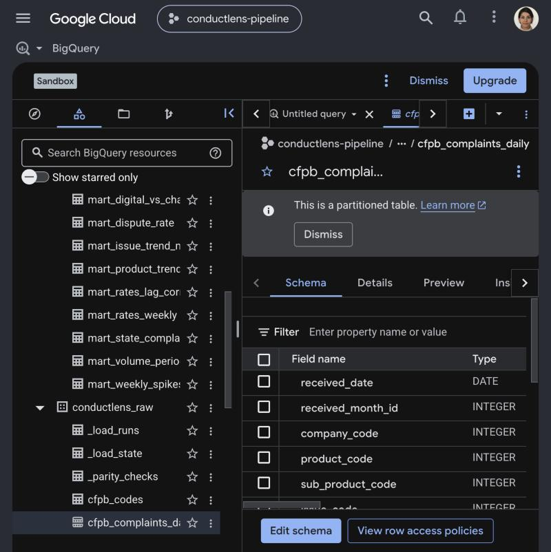
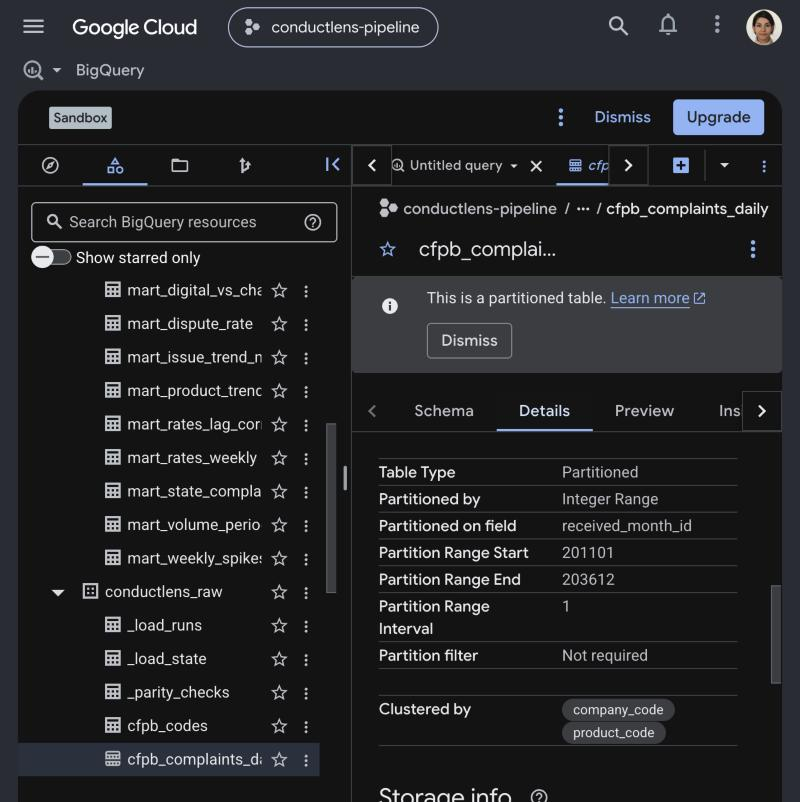
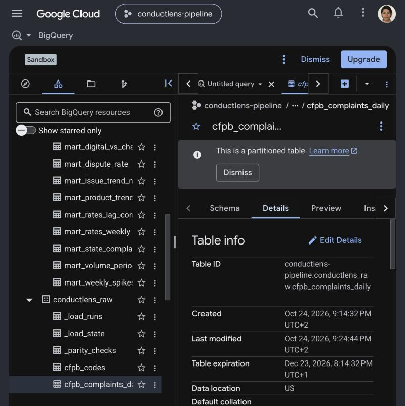

5,163,903 cells that sum to exactly 18,653,525 complaints:

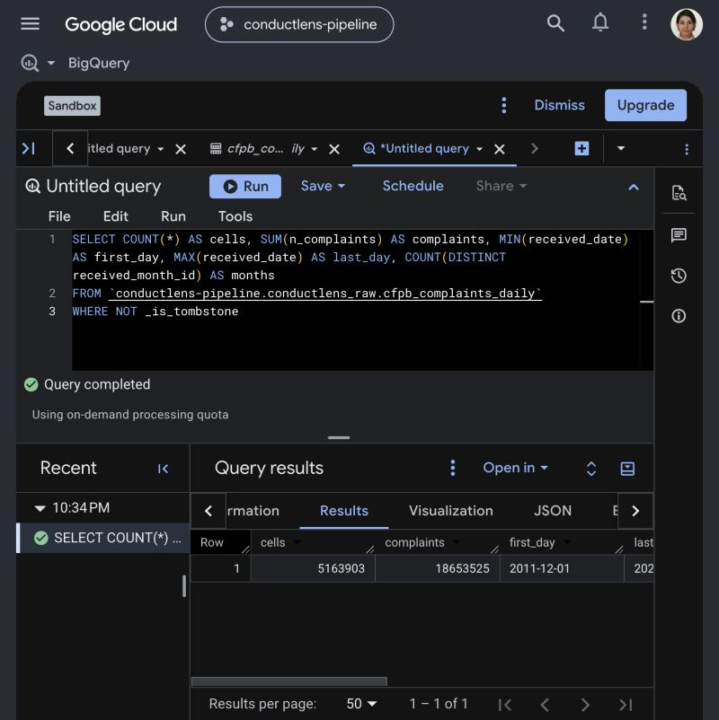

## Why two warehouses

The brief asks for BigQuery, and BigQuery is where the pipeline is designed and documented. The
project runs it as a **sandbox** (no billing account), and the sandbox has one rule that no amount
of code can bypass: **every table, view and partition is deleted 60 days after it is created**, and
the expiration cannot be removed. Two more rules shape the design: there is no DML (no `MERGE`,
`UPDATE` or `DELETE`), and storage is a lifetime 10 GiB budget that deleting data does not refund.

For dbt-managed tables that is survivable, because `CREATE OR REPLACE` every day resets the clock.
For the raw layer it is not: a table holding years of complaint history would vanish on day 61
and have to be reloaded from scratch, and every reload spends the lifetime budget again. A public
dashboard bound to those tables would go dark for the hours between the expiry and the next
scheduled run, and the history of every load (`_load_runs`, the watermarks) would vanish with it.

So the same ingestion writes a second copy to **Databricks Free Edition**, and the same dbt project
builds the same marts there:

| | BigQuery sandbox | Databricks Free Edition |
|---|---|---|
| Cost | free, no billing account | free |
| Table lifetime | **60 days, then dropped** | **no expiration; tables persist** |
| DML | none (load jobs and DDL only) | full `MERGE`, so the version log is a true upsert |
| Storage | 10 GiB lifetime budget | no comparable cap at this size |
| Complaint grain held | daily cells (5.2M rows, 0.69 GB) | complaint level (18.65M rows, 421 MB Delta) |
| Role | the warehouse the brief asks for; rotated and rehydrated automatically | the copy that is always there; what the public app reads |

The two copies are built by one dbt project (`dbt build --target bq` and `--target dbx`), and a
daily `parity_check` task compares every mart's row count and numeric sums across them; the first
runs matched 14 of 14. Pointing Hex at Databricks is therefore a connection choice, not a different
dashboard, and if the BigQuery project ever gets a billing account the app can be rebound without
changing a query.

The Databricks side, as seen in Catalog Explorer: the fourteen marts, the complaint table with its
18.65 million rows and liquid clustering on date and company, and the row-count query.

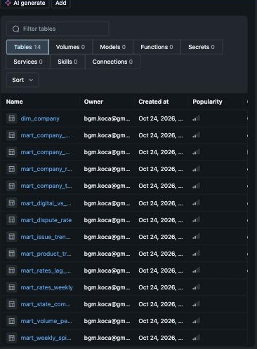
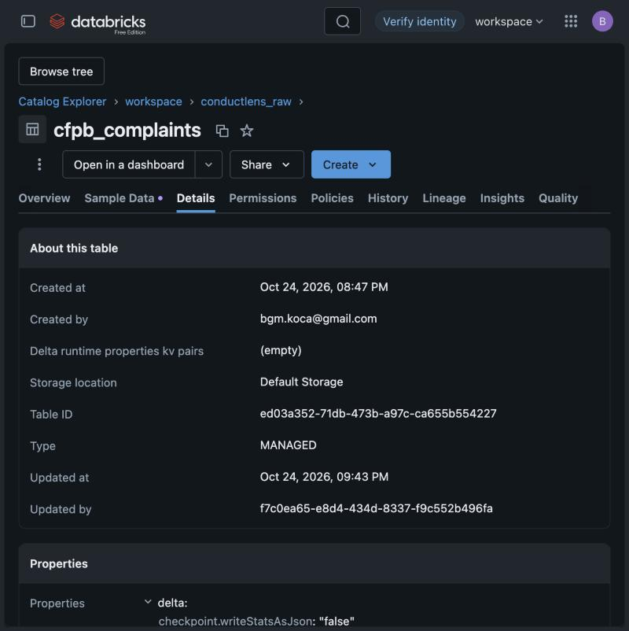
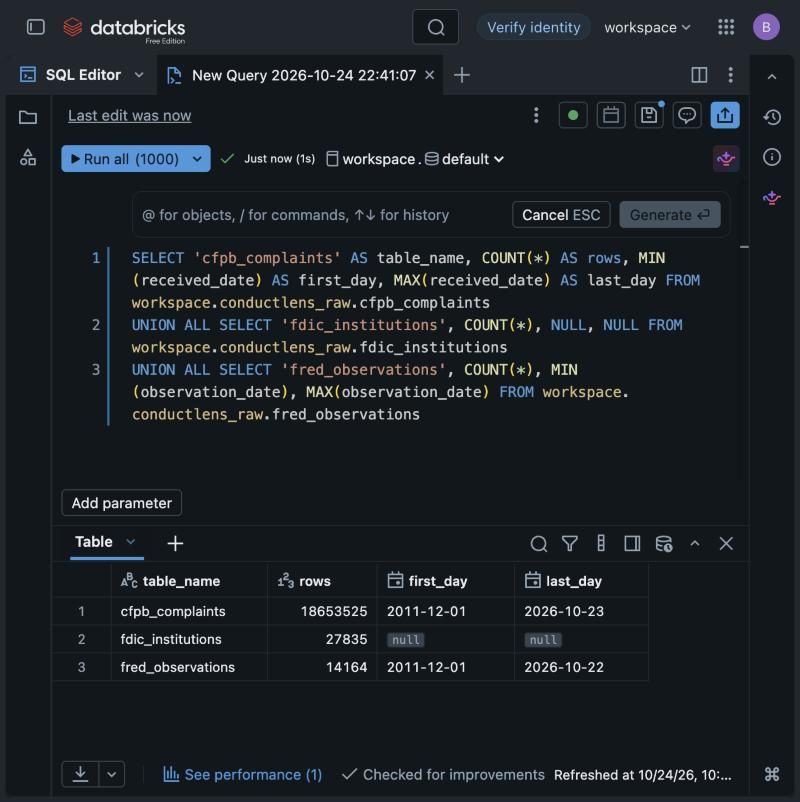

## dbt

The `conductlens` project in `dbt/`: 23 models, 153 tests, 5 seeds, 1 snapshot, 1 exposure.

```
staging        stg_cfpb_complaints_daily  stg_fdic_institutions  stg_fred_observations
intermediate   int_complaints_daily  int_company_mapping  int_product_groups
               int_fdic_deposits_by_holding  int_rates_daily  int_complaints_weekly
marts          dim_company  mart_volume_periods  mart_product_trend_monthly
               mart_issue_trend_monthly  mart_company_timeliness_monthly
               mart_company_resolution  mart_dispute_rate  mart_company_benchmark
               mart_digital_vs_chartered  mart_weekly_spikes  mart_rates_weekly
               mart_rates_lag_correlation  mart_state_complaints  mart_company_match_coverage
snapshot       snap_fdic_institutions   (check strategy on name, holding company, deposits, assets)
seeds          company_fdic_map  digital_first_companies  product_groups  state_population  state_regions
```

Staging picks the newest version of every key and drops tombstones. `int_complaints_daily` is the
single model every mart reads, which keeps the mart SQL identical wherever the project runs. Tests
go beyond unique and not-null: accepted values on every category, relationships from the marts to
`dim_company`, `accepted_range` on every share and correlation, singular tests that assert the
spike maths and the current-version uniqueness, and an honesty test that **warns** when the share of
bank-product complaints matched to an FDIC charter drops below 85 %. `dbt docs generate` produces
the lineage and column documentation; every column has a description.

## Apache Airflow

Airflow 2.10 runs in Docker Compose (`airflow/`), scheduler plus webserver plus a Postgres
metadata database. dbt models are rendered into individual tasks with astronomer-cosmos.

| DAG | Schedule | What it does |
|---|---|---|
| `conductlens_daily` | `0 13 * * *` | `ensure_tables` → `ingest.{cfpb,fdic,fred}` → dbt task group (46 `run` and `test` tasks) → `parity_check` → `write_evidence` |
| `conductlens_weekly_full_diff` | Sundays 14:00 UTC | re-hash the whole CFPB file to catch late corrections, then trigger the daily DAG |
| `conductlens_backfill` | manual | typed params `start`, `end`, `sources`, `sinks`; one task per source; triggers the daily DAG afterwards |

Why 13:00 UTC: the CFPB file is refreshed around 09:00 UTC and FRED has published the previous
business day by then, so one run catches both. `catchup=False` and `max_active_runs=1`: a missed
day needs no replay because the next run's 60-day window already covers it.

The first two end-to-end runs, 99 tasks each, both green:

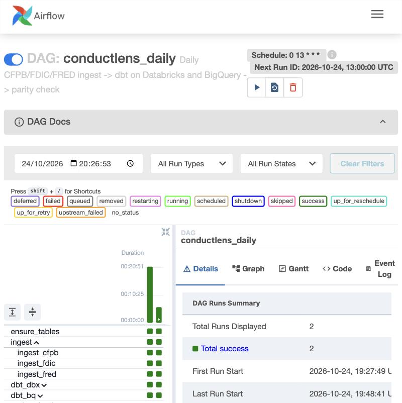

Every dbt model as its own task with its own tests, and the lineage Cosmos draws from `ref()`:

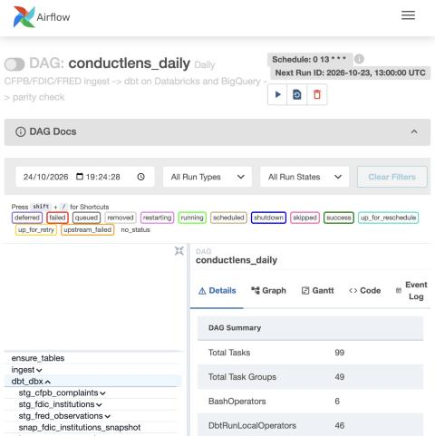
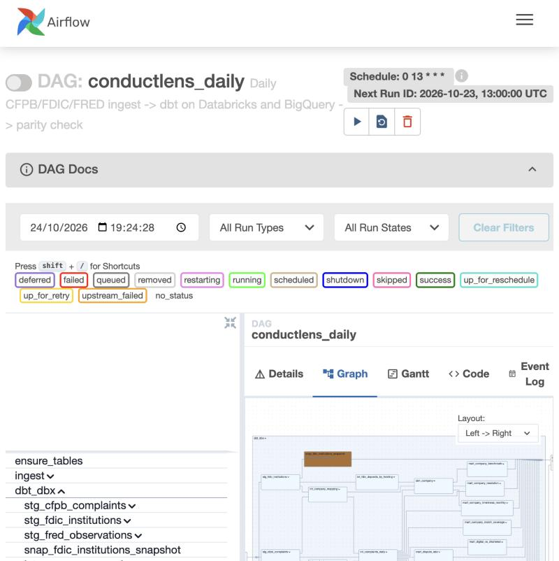

The 23 BigQuery dbt tasks of one run, all successful:

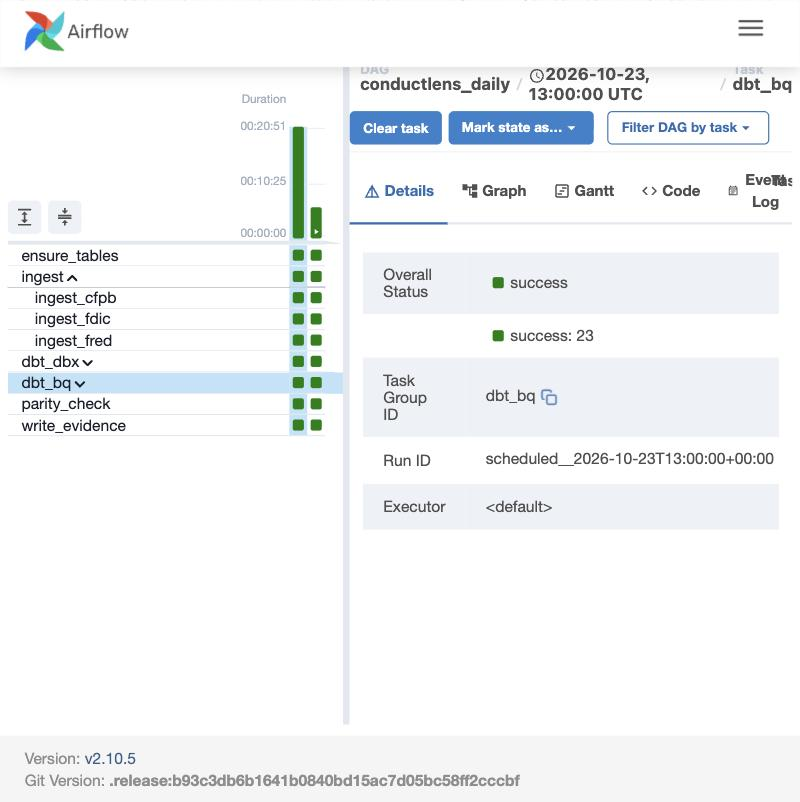

The parameterised backfill form:

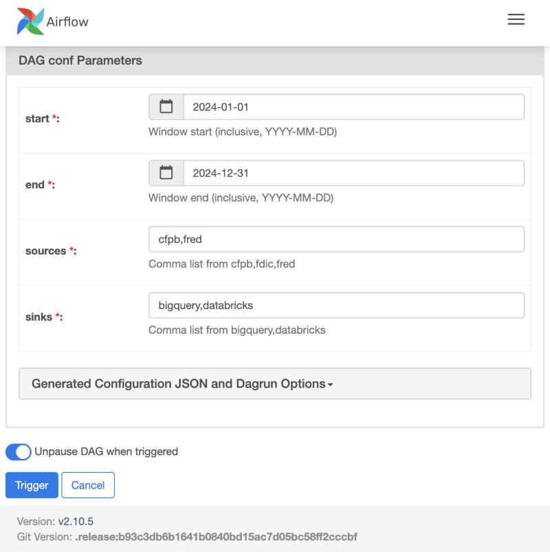

## Hex dashboard

The public app reads the `conductlens_marts` tables: sixteen SQL cells for the ten questions, a
`Company` selector (every company with at least 100 complaints in the trailing year, default
Ally), five charts and an honesty panel. Dates on the app are CFPB US-Eastern calendar dates and
"today" is US/Eastern.

**Q1 and the opening tables**

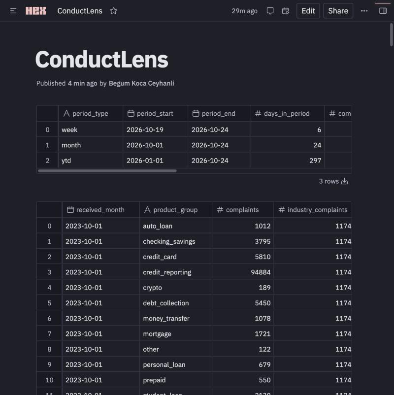

**Q2 - monthly complaints by product group.** Credit reporting is the whole story of the last three
years; the three bureaus account for 14.7 of the 18.7 million complaints.


**Q3 - share answered within the 15-day window** for the selected company, monthly and trailing
twelve months.

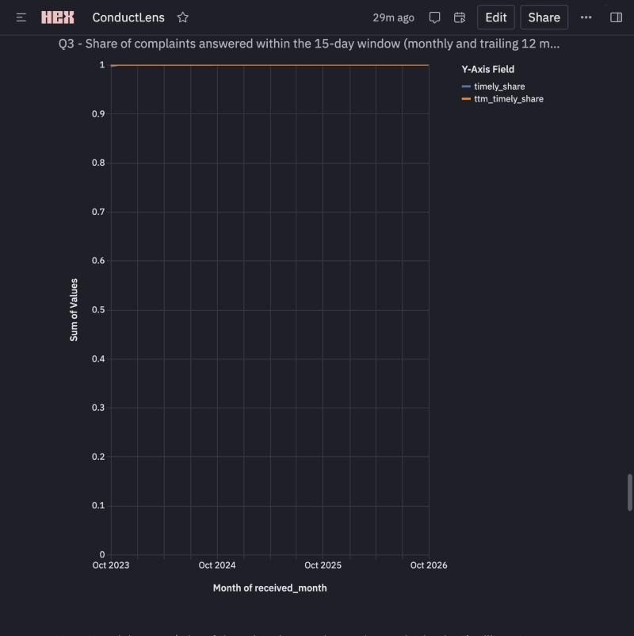

**Q6 - complaints per $1bn of deposits** among chartered peers in our size bucket, our bank
highlighted. Fintechs without a charter get their own, unnormalised table underneath.

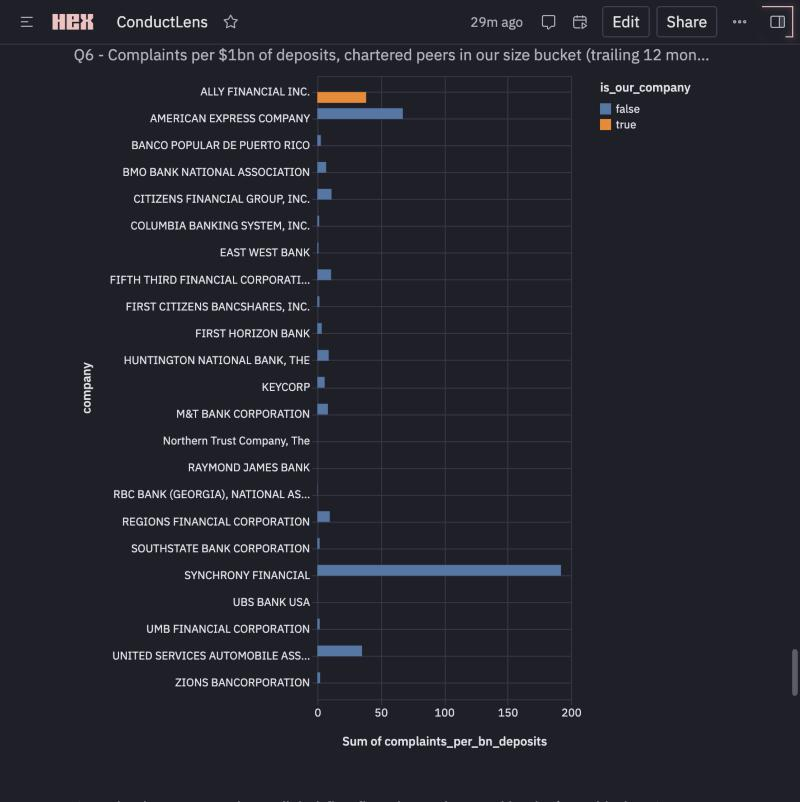

**Q7 - timely-response share, digital-first fintechs vs chartered banks.**

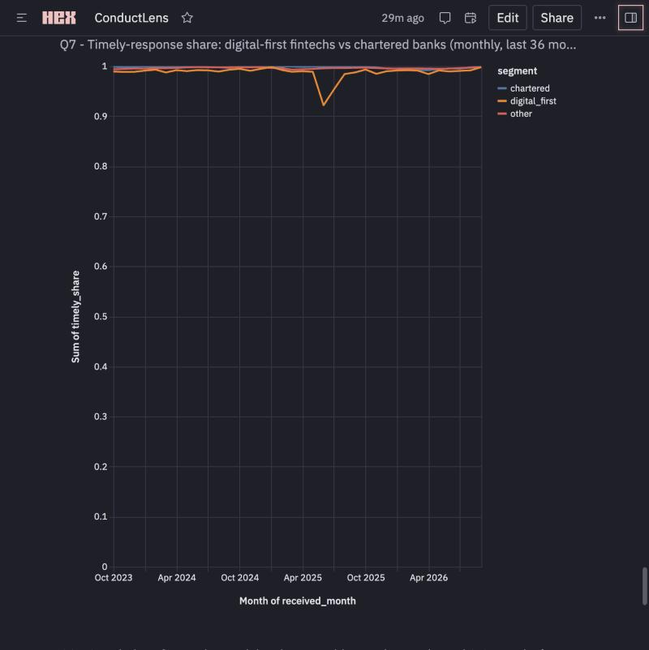

**Q9 - correlation of 4-week complaint changes with rate changes lagged 0 to 26 weeks**, mortgage
and credit card side by side. The lag arithmetic lives in the mart, not in the chart.

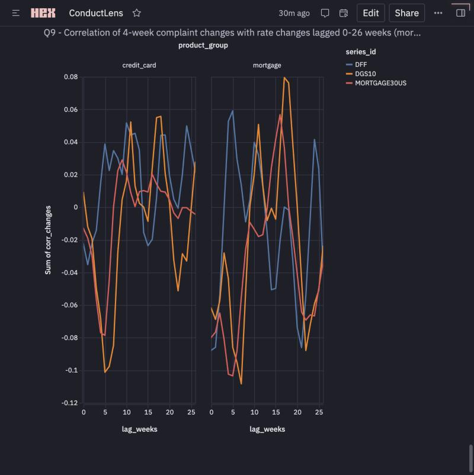

**The honesty panel:** how much complaint volume sits behind each company-matching method.

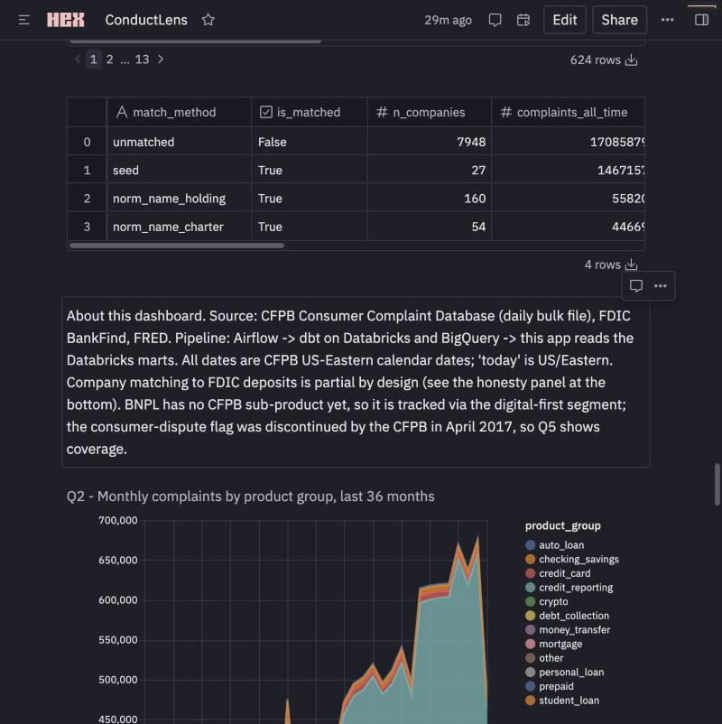

## Design decisions

**1. Complaint rows mutate, so the raw layer is an append-only version log and every run
re-pulls a trailing window.** A complaint appears in the file the day it is received; the company
response, the timeliness flag and (historically) the dispute flag fill in over the following
weeks. `cl-ingest` hashes the business columns of every complaint in the window
`[watermark − 60 days, today]`, appends only `(complaint_id, row_hash)` pairs the warehouse does
not already have, and staging picks the newest `_loaded_at` per id. A key the warehouse has in that
window but the file no longer has gets a tombstone row. Re-running any window re-derives the same
hashes and writes nothing, so *Clear* in Airflow is always safe and a backfill of 2024 is the same
code path with explicit dates. Because the bulk file is the whole database every day, a weekly
`full_diff` applies the same comparison to all 18.7 million rows and catches the rare mutation
older than 60 days.

**2. Company names are free text, so matching is a seed plus a normalised-name join, and the
match rate is published, not assumed.** The CFPB writes `JPMORGAN CHASE & CO.`; the FDIC has
several charters under holding company `JPMORGAN CHASE & CO` plus charters whose names say nothing
about the parent. `int_company_mapping` tries, in order: the manual seed `company_fdic_map.csv`
(CFPB name → FDIC holding-company RSSD id or `CERT-<n>`), then a normalised-name match against
holding-company names, then against charter names. Normalisation upper-cases, strips punctuation
and legal suffixes (INC, LLC, N.A., CORPORATION, HOLDINGS, FINANCIAL, BANCORP …). Every row carries
`match_method`, `mart_company_match_coverage` reports the share of complaints per method, and a
test warns when matched volume among bank-product complaints drops below 85 %. The overall match
rate is deliberately not the headline: 80 % of all complaints are about the three credit bureaus,
which are not banks and are not supposed to match.

**3. Deposit normalisation only exists for chartered banks, so fintechs get their own,
unnormalised peer group.** PayPal, Chime, Affirm and Coinbase have no FDIC charter and no deposits
of their own. `mart_company_benchmark` has `peer_group = 'chartered'` (complaints per billion
dollars of deposits, ranked inside size buckets <1B, 1–10B, 10–50B, 50–250B, >250B) and
`peer_group = 'fintech_unnormalised'` (ranked by raw trailing-twelve-month volume among
themselves). Nobody is silently dropped, and the dashboard shows both tables.

**4. Narratives are never landed.** The free-text narrative is the bulk of the raw bytes, it
contains personal detail even after redaction, and none of the ten questions needs it. The bulk
file no longer ships narratives and the API client never requests the field; the schema keeps a
`has_narrative` boolean so the existence of a narrative can still be analysed. On the sandbox this
is also what makes the project fit at all.

**5. Partition by received month, cluster by company.** Every dashboard query filters on a
received-date range and most group by company. The big table is partitioned on
`received_month_id` (an integer such as `202610`) and clustered by company and product. An integer
month rather than a `DATE` partition because in the sandbox every partition also expires 60 days
after its boundary, which would delete all history older than two months on a date-partitioned
table; integer-range partitions have no partition expiration and still prune the trailing-window
marts (Q1, Q3, Q8).

**6. Rates are a different grain, and the lag lives in a mart.** FRED series are daily, weekly
or quarterly. `int_rates_daily` forward-fills every series onto a daily spine; `mart_rates_weekly`
averages rates and sums mortgage and credit-card complaints by week; `mart_rates_lag_correlation`
computes, for lags of 0 to 26 weeks, the correlation between complaint volume and the lagged rate,
on levels and on 4-week changes (complaint volume grew 50× over the period, so levels alone would
just show the trend). Hex only draws the table, so the number is testable and the same everywhere.

**7. The sandbox cannot hold 18.7 million mutable rows, so BigQuery holds the daily-cell
grain.** The sandbox terms are a lifetime 10 GiB of storage "not refunded upon data deletion",
expiry of every table after 60 days, and no DML. The complaint-level log measures 7.7 GB of
BigQuery logical bytes, and keeping it alive means rewriting it every 60 days: about 46 GB a year
against a 10 GiB lifetime. All ten questions are aggregates over
`(received_date, company, product, sub-product, issue, state, response, timely flag, dispute
flag)`. That grain has 5.16 million cells for all of history and, with the strings replaced by
integer codes, costs 0.69 GB per rotation, about 3 MB a day of new cell versions and about 3 MB a
day of mart rebuilds: roughly 6.5 GB a year, so the sandbox lasts about 18 months before billing
has to be enabled, at which point the same data costs under a dollar a month. The cell log follows
the same version-log rules as everything else, and one env var (`CL_BQ_CFPB_GRAIN=complaints`)
switches back to complaint-level rows once billing exists.

**Other calls worth a sentence.** *Bulk file over API*: the CFPB search API is geo-fenced
(HTTP 403 outside the US); the bulk file is reachable everywhere and its `Last-Modified` date
becomes `_source_as_of`. *Dispute rate (Q5)*: the CFPB stopped collecting "consumer disputed?" on
2017-04-24 and the bulk export dropped the column; `mart_dispute_rate` publishes `coverage_share`
next to every rate so nobody reads a 2016 number as current. *15-day window (Q3)*: the CFPB's own
`Timely response?` flag is the measure; the response date is not published, so it is not
recomputed. *BNPL*: no CFPB sub-product currently contains "buy now, pay later", so the `bnpl`
product group is wired but empty, and BNPL lenders are tracked through the digital-first segment.
*FRED User-Agent*: fred.stlouisfed.org drops connections for unknown User-Agent strings, so the
FRED client uses the library default and the code says why.

## Time zone

CFPB "Date received" and "Date sent to company" are US-Eastern **calendar dates** with no time
component. They are stored as `DATE`, compared as dates, and never converted. "This week", "this
month" and "year to date" use today's date in `America/New_York`, so a 13:00 UTC run and a
23:30 UTC run agree on what "today" is. Weeks start on Monday. Audit timestamps are UTC.

## What a failure looks like, and how the pipeline recovers

**A red task.** Open its log. Ingest tasks end with the source, the window and a plain error
(`HTTP 403 … blocked for this network (geo-fence?)`, `bulk download truncated: n of m bytes`,
`FDIC returned only 12 institutions; refusing to treat that as truth`). Every attempt is a row in
`_load_runs` with `status`, `error`, rows read and written, and `_load_state` shows the watermark.
Transient errors are retried twice with exponential backoff. For a real bug: fix the cause and
*Clear* the task. Ingestion is idempotent, so re-running never duplicates. A dbt task is one model;
clear just that model and its downstream.

The first real run produced two such failures, and both recoveries are in the evidence file. The
ingest tasks failed on a CLI argument bug; after the fix, the whole group was cleared and re-ran,
writing 0 rows:

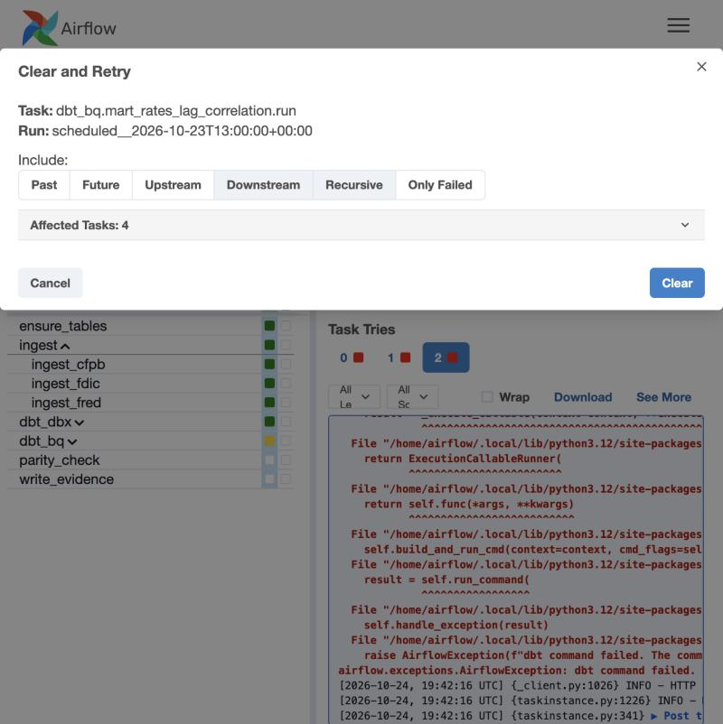

`mart_rates_lag_correlation` failed on BigQuery because `groups` is a reserved word there; after a
one-line rename only that model and its three downstream tasks were cleared, 94 others untouched:

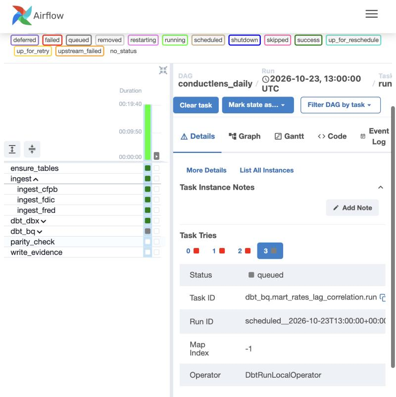

**The failure this design exists for: a BigQuery table expired.** `ensure_tables` runs first on
every daily run. It reads each raw table's expiry; a table within 5 days of expiry is rotated
(copy job → drop → rename, one write, history kept); a table that is already gone is recreated and
**rehydrated** from the day's parquet, quarter by quarter, logged as `mode = 'rehydrate'`. Marts
and views are rebuilt by dbt each day, which resets their 60-day clock. Nothing manual. The
dashboard keeps serving from the backup copy throughout.

**Other failures.** A half-finished CFPB load leaves only complete, correct versions behind (each
quarter chunk is its own upsert; the watermark moves only after the whole window succeeds). A CFPB
schema change fails the parquet conversion before anything is written. An empty FDIC answer is
refused rather than loaded, so `dim_company` can never lose its deposits silently.

## Footprint and cost

Measured on 2026-10-24.

| what | measured |
|---|---|
| CFPB bulk zip / CSV / normalised parquet | 358 MB / 5.65 GB / 163 MB; CSV → parquet in 22 s |
| Complaints in the file | 18,653,525, 2011-12-01 → 2026-10-23, 8,189 distinct company strings |
| BigQuery `cfpb_complaints_daily` first load | 5,163,903 cells = 18,653,525 complaints exactly; ~0.69 GB logical; 10 min |
| `cfpb_codes` dictionary | 8,189 companies, 178 issues, 86 sub-products, 63 states, 21 products, 8 responses |
| Databricks `cfpb_complaints` (full history, Delta) | 18,653,525 rows, 421 MB, clustered by `received_date, company`, no expiration |
| FDIC / FRED | 27,835 institutions / 14,164 observations |
| Daily incremental run, 60-day window | 150,568 cells read, 0 written when nothing changed |
| `dbt build` on BigQuery | 14 tables, 9 views, 152 tests in 35 s |
| Full `conductlens_daily` run | 99 tasks, 21 min |
| Estimated lifetime-budget use, first year | ~6.5 GB of 10 GiB |
| Estimated query bytes | ~15 GB/day → ~450 GB/month of the 1 TiB free |

## Evidence of unattended runs

`evidence/scheduled_runs.md` is written by the last task of every daily run from `_load_runs` and
`_parity_checks`. The first two end-to-end runs on 2026-10-24 (manual trigger and the first
scheduled interval) are in it, 99 tasks each, both green, including the two failures and their
recoveries described above. The two unattended 13:00 UTC runs the brief asks for are appended as
they happen.

## Budget

Scope as specified was two to three weekends.

| | |
|---|---|
| Source research (sandbox terms, geo-fenced API, bulk-file schema, FDIC/FRED endpoints) | done |
| Ingestion package + 12 unit tests | done |
| dbt project (seeds, snapshot, 153 tests, docs) | done, builds green |
| Airflow stack (Cosmos task groups, 3 DAGs, docker compose) | done, two runs green end to end |
| BigQuery sandbox provisioning and first loads | done |
| Hex app, public link | done |
| Two unattended scheduled runs, screenshots | open, two calendar days |

What was cut: no CI; the API-only columns stay empty unless the pipeline runs from a US network;
state population is a static seed rather than a Census API pull; no alerting beyond the structured
failure log.

## :open_file_folder: Folder structure

```
conductlens-pipeline/
├── ingestion/          cl-ingest package: sources, sinks, runner, parity, evidence; tests/
├── dbt/                conductlens project: models, seeds, snapshots, macros, tests, profiles.yml
├── airflow/            docker-compose.yml, Dockerfile, dags/ (daily, weekly full_diff, backfill)
├── hex/                queries.sql (one block per question) and the app notes
├── scripts/            bootstrap steps for BigQuery and the warehouse, evidence helpers
├── docs/               ARCHITECTURE.md (the cross-component contract), img/ (screenshots)
├── evidence/           scheduled_runs.md written by the pipeline
├── Makefile            setup, ingest, dbt, airflow, evidence targets
└── pyproject.toml      Python 3.12, uv
```

## :exclamation: Requirements

- Python 3.12 with `uv`, Docker Desktop
- A Google Cloud project with the BigQuery sandbox enabled and a service account holding
  *BigQuery Data Editor* and *BigQuery Job User* (key saved to `secrets/bq-service-account.json`)
- A Hex workspace for the public app
- `cp .env.example .env`, fill it, then `make setup && make ensure-tables && make ingest-all && make dbt-bq`
- `cp airflow/.env.example airflow/.env`, fill it, `make airflow-up`, open http://localhost:8080

## :smiley_cat: Author

Begum Koca · [@begussimo](https://github.com/begussimo)
